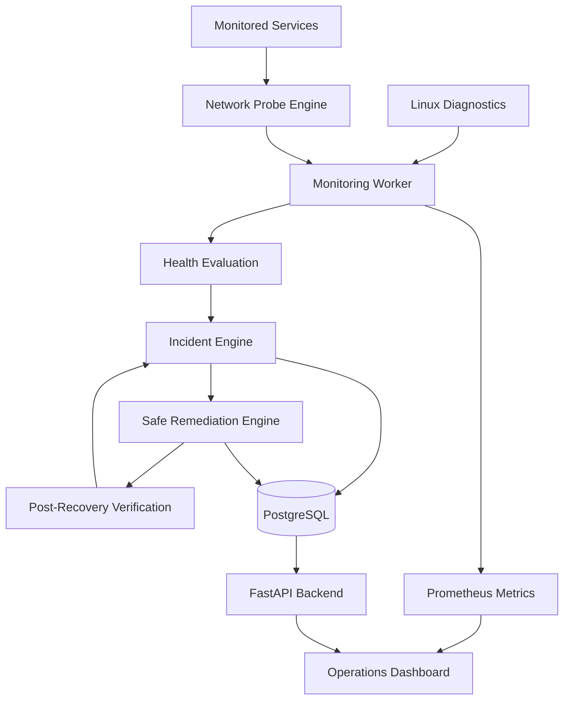

# NetOps Sentinel


### Network Operations Automation & Observability Platform

A production-style network operations platform built with Python, FastAPI, Linux, and React to monitor service health, diagnose failures, correlate incidents, and execute controlled recovery workflows.

**Focus areas:** Network Monitoring · Linux Diagnostics · Incident Management · Safe Automation · Observability · Reliability Engineering

---

## Overview

NetOps Sentinel provides a centralized Network Operations Center (NOC) for monitoring network services and investigating operational failures.

The platform combines active network probes, Linux system diagnostics, incident correlation, safe remediation, and Prometheus metrics in a unified dashboard.

It is designed to demonstrate practical software engineering concepts relevant to distributed systems, network operations, automation, and reliable service delivery.

## Key Features

### Network Health Monitoring
- HTTP and HTTPS endpoint monitoring.
- DNS resolution and TCP connectivity checks.
- Response-time measurement and latency analysis.
- TLS certificate validity and expiration checks.
- Configurable timeouts, failure thresholds, and retry policies.
- Service health states: `HEALTHY`, `DEGRADED`, `DOWN`, and `UNKNOWN`.

### Linux System Diagnostics
- CPU utilization and load averages.
- Memory and disk usage.
- Process-level resource information.
- Network interface inspection.
- Bash-based diagnostic and health-check scripts.
- Container and host environment identification.

### Incident Detection and Investigation
- Threshold-based incident creation.
- Consecutive-failure detection.
- Incident deduplication and timeline tracking.
- Evidence-based probable-cause classification.
- Incident status transitions and resolution history.

### Safe Remediation Engine
- Allowlisted recovery actions.
- Role-based authorization for administrative operations.
- Dry-run support and cooldown protection.
- Recovery execution logs and audit history.
- Post-recovery health verification.
- Protection against arbitrary shell-command execution.

### Observability
- Prometheus-compatible metrics at `/metrics`.
- Structured application logging.
- Correlation IDs for request and probe tracing.
- Service availability and latency metrics.
- Incident and recovery statistics.

### Operations Dashboard
- Service health overview and monitoring controls.
- Incident investigation and event timelines.
- Linux diagnostics interface.
- Remediation execution console.
- Chaos simulation for controlled failure scenarios.
- Prometheus metrics viewer.

---

## Technology Stack

| Component | Technologies |
|---|---|
| Backend | Python, FastAPI, Pydantic, Uvicorn |
| Network Probes | HTTPX, TCP sockets, DNS resolution, TLS inspection |
| System Diagnostics | Linux, Bash, psutil |
| Frontend | React, TypeScript, Vite, Tailwind CSS, Recharts |
| Database | PostgreSQL, SQLAlchemy |
| Observability | Prometheus, structured logging |
| Infrastructure | Docker, Docker Compose |
| Testing | Python unittest/pytest-compatible test workflows |
| CI/CD | GitHub Actions |

*Verify the final dependencies and supported commands against the repository before publishing.*

---

## Architecture



The monitoring worker operates independently of the frontend. The backend exposes operational data and management APIs, while the dashboard provides a centralized interface for investigation and recovery.

---

## Dashboard Screenshots

Add your actual screenshots to a `docs/screenshots/` directory and update the filenames below.

### Services Health


### Linux Diagnostics


### Remediation Engine


---

## Getting Started

### Prerequisites

- Git
- Docker Engine or Docker Desktop
- Docker Compose v2

Python and Node.js are also useful for running individual components outside containers.

### Installation

Clone the repository:

```bash
git clone https://github.com/jiten54/netops-sentinel.git
cd netops-sentinel
```

Review the available configuration files, including `.env.example` and `.env.docker.example`, if present. Configure the required environment variables according to the repository's deployment instructions.

Start the application:

```bash
docker compose up --build
```

Wait for the services to become healthy before opening the dashboard.

### Access the Services

Use the actual port mappings configured in `docker-compose.yml`.

| Service | Typical local URL |
|---|---|
| Frontend dashboard | `http://localhost:5173` |
| FastAPI backend | `http://localhost:8000` |
| API documentation | `http://localhost:8000/docs` |
| Prometheus metrics | `http://localhost:8000/metrics` |
| Prometheus interface | `http://localhost:9090` |

These are example URLs; confirm the exposed ports in your Compose configuration.

### Stop the Application

```bash
docker compose down
```

To remove the associated database volume and reset persisted data, review the Compose volume configuration before running:

```bash
docker compose down -v
```

**Warning:** Removing volumes deletes persisted application data.

---

## Running Tests

Run the test suite using the command supported by the repository:

```bash
python3 -m unittest discover -s tests -p 'test_*.py' -v
```

The current project-generation report records **12 passing tests** covering network probe failures, incident handling, remediation authorization, cooldowns, dry-run behavior, and recovery verification.

Re-run the tests in your final repository before treating this result as verified.

---

## Failure Simulation

Use the controlled Chaos Simulator to demonstrate the incident lifecycle in a local test environment.

1. Select a supported failure scenario, such as an HTTP error or elevated latency.
2. Trigger the failure against a controlled test service.
3. Observe the health-check results and incident creation.
4. Inspect the recorded diagnostics and probable-cause evidence.
5. Select an authorized, allowlisted remediation action.
6. Review the execution logs and post-recovery health checks.
7. Confirm that the incident resolves only after the configured verification conditions are satisfied.

Only simulate failures against services you own or are authorized to test.

---

## Security Considerations

- Use environment variables for credentials and sensitive configuration.
- Never commit secrets or production credentials.
- Restrict monitoring targets to approved destinations.
- Protect administrative actions with authentication and authorization.
- Use predefined remediation actions instead of arbitrary shell execution.
- Apply timeouts, retry limits, and cooldowns.
- Keep recovery actions restricted to controlled test services unless appropriate production safeguards are implemented.

---

## Project Structure

```text
netops-sentinel/
├── backend/
│   ├── config.py
│   ├── models.py
│   ├── schemas.py
│   ├── prober.py
│   ├── diagnostics.py
│   ├── incident_engine.py
│   ├── recovery_engine.py
│   ├── database.py
│   └── main.py
├── worker/
│   └── monitoring_worker.py
├── scripts/
│   ├── diagnostics.sh
│   ├── health_check.sh
│   ├── network_probe.sh
│   └── chaos_inject.sh
├── src/
│   ├── components/
│   ├── App.tsx
│   └── index.css
├── tests/
├── .github/
│   └── workflows/
├── Dockerfile
├── Dockerfile.worker
├── Dockerfile.frontend
├── docker-compose.yml
├── prometheus.yml
├── requirements.txt
└── README.md
```

Confirm this structure against the final repository and adjust it if any files differ.

---

## Engineering Principles

- Separation of concerns between API, monitoring, diagnostics, and recovery.
- Observable and testable operational workflows.
- Evidence-based incident analysis.
- Controlled automation with auditability.
- Graceful failure handling and bounded retries.
- Reproducible development and deployment.

## Future Improvements

- Multi-region monitoring and distributed probe agents.
- Alert delivery through configurable notification integrations.
- More advanced anomaly detection for latency and availability.
- Expanded integration and load testing.
- Additional authentication and operational audit controls.
- Improved service-level objective reporting.

## Author

**Jiten Moni Das**

- GitHub: [@jiten54](https://github.com/jiten54)
- LinkedIn: [Jiten Moni Das](https://linkedin.com/in/jiten-moni-das-01b3a032b/)

---

*NetOps Sentinel is a portfolio project developed to demonstrate network operations, software engineering, Linux diagnostics, automation, and observability concepts. It is not affiliated with or endorsed by Akamai Technologies.*
